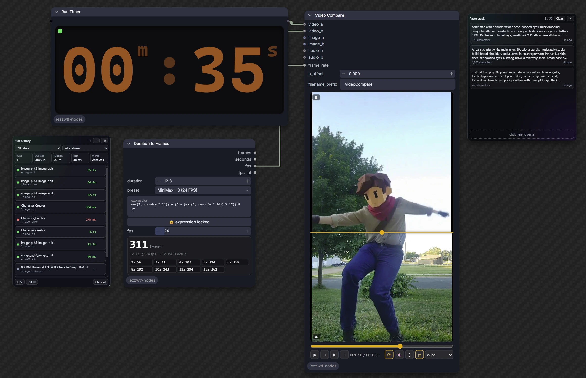

# JezzWTF QoL Nodes



Quality-of-life nodes and canvas tools for [ComfyUI](https://github.com/comfyanonymous/ComfyUI): utilities, character chat and cards, LoRA and model loaders, MiniMax H3 RefMod, GIF tools, a run timer with history, and a clipboard paste stack.

Each node family loads in its own `try/except`, so a problem in one can't take down the others.

# Table of contents

- [Installation](#installation)
- [Requirements](#requirements)
- [Nodes](#nodes)
  - [Utilities](#utilities)
  - [Run Timer](#run-timer)
  - [Characters and LLMs](#characters-and-llms)
  - [Loaders and LoRA](#loaders-and-lora)
  - [MiniMax H3 RefMod](#minimax-h3-refmod)
  - [Video](#video)
  - [GIF Tools](#gif-tools)
- [Frontend extensions](#frontend-extensions)
- [Example workflows](#example-workflows)
- [License](#license)

# Installation

## ComfyUI Manager

Search for **JezzWTF QoL Nodes** and install it.

## Manual

```bash
cd ComfyUI/custom_nodes
git clone https://github.com/JezzWTF/jezzwtf-nodes
```

Restart ComfyUI, then hard-refresh the browser tab.

# Requirements

- **ComfyUI 0.44.0 or newer.** This is the version the pack is tested on.
- **Local ComfyUI only.** The pack reads and writes local folders, talks to LM Studio and Civitai, keeps run history on disk and reads the OS clipboard, so it is not meant for Comfy Cloud.
- Nothing else to install. Some features use optional packages when they are present:

| Package | Used for |
|---|---|
| `imageio-ffmpeg` or a system `ffmpeg` | GIF Tools (falls back to Pillow with a warning) |
| `opencv-python` | Video frame sampling for LM Studio and Character Chat |
| `soundfile` | Sending audio to LM Studio |
| `requests` | LM Studio streaming |

Model-specific nodes also need the matching model: a Qwen3.5 text encoder for Character Chat, a MiniMax H3 checkpoint for the H3 nodes, and so on.

# Nodes

## Utilities

Categories `JezzWTF/utils`, `JezzWTF/image`, `JezzWTF/dataset` and `JezzWTF/conditioning`.

| Node | What it does |
|---|---|
| Set (Remote) / Get (Remote) | Pass any value across the graph by key, no wires |
| Text Box | Reusable prompt card with live counts, copy and clear |
| Text Encode (Zero Negative) | Encode the positive prompt and build a zeroed or empty negative in one node |
| Title Font | Styled title banner for organising workflows |
| Edit Prompt Template | Edit instruction plus optional suffix and separator |
| Duration to Frames | Seconds to frame count, with model presets and a safe expression field |
| Resolution Picker | Aspect ratio and megapixels (or a preset) to width, height and an empty latent |
| Match Image Size | Resize or pad one image to another's size, with several fit modes |
| Image Aspect Size | Aspect-aware size output for an image |
| Get Image | Grab an in-graph image as IMAGE and MASK |
| Draw Image | Layered sketch pad that loads like Load Image, with pressure, undo and zoom |
| Multi Load Image | Up to 16 image slots, each with its own output |
| Multi Switch | Route several values by one switch |
| Folder Image Batch / Folder Video Batch | One file per run from a folder, with whole-folder auto-run |
| Save Caption (Match Image) | Save a caption as a `.txt` named after the file just loaded |
| Batch Timer | Counts finished items across queued prompts, with progress and ETA |
| Refresh Page (VRAM Cleaner) | Pass-through node that frees VRAM and reloads on demand |

## Run Timer

A non-destructive timer for a whole workflow run. A wired value passes through unchanged, and the node also works unconnected.

- Big clock card on the node, with a status dot and a colon that beats once per second while running.
- Every timed run is saved on the server (newest 500), so history survives reloads.
- A floating history panel, like Paste Stack: draggable, resizable, minimizes to a chip showing the running time. It has count, average, median, best and worst, filters by label and status, per-row delete, and CSV and JSON export.
- Rename the node to label its runs in the history.

## Characters and LLMs

Categories `JezzWTF/LLM` and `JezzWTF/Cards`.

| Node | What it does |
|---|---|
| Character Chat | Chat with V1, V2 and V3 character cards (PNG, JSON or refmod `.safetensors`) on Qwen3.5 through ComfyUI's text generation, with lorebooks, a chat panel and Save chat |
| Character Card PNG Baker | Bake a Character Card V2 into a PNG, saved to `input/characters` so Character Chat lists it |
| Workflow PNG Baker | Embed a workflow or prompt into a PNG |
| LM Studio Bridge / Prompt Box | Streaming chat, vision, audio and video through any model in LM Studio |
| Bounding Boxes / Layout LLM Prompt | Draw layout boxes on a canvas, or let an LLM draw them |

## Loaders and LoRA

Categories `JezzWTF/loaders` and `JezzWTF/lora`.

| Node | What it does |
|---|---|
| Diffusers Loader | Load a Diffusers folder as MODEL, CLIP and VAE |
| Ultimate Model Loader | Diffusion model, two CLIPs and two VAEs with attention backend and quantisation options |
| LoRA Stack / LoRA Folder Stack (+ Multi-Model) | LoRA stack editor with favourites, folder filter and a randomizer |
| LoRA Inspector | Identify a LoRA through Civitai: trigger words, base model, samples |
| Regional Character LoRA | Two character LoRAs in one image, each confined to its own region |

## MiniMax H3 RefMod

Categories `JezzWTF/refmod` and `JezzWTF/sampling`.

A RefMod is a `.safetensors` file of reference latents (portraits, a short clip, a voice sample) baked through H3's own VAEs, then injected into video conditioning as reference tokens. A refmod can also carry a character card in its header, which Character Chat reads.

| Node | What it does |
|---|---|
| RefMod Bake (Character) / Loader / Apply | Bake references into a file, load it, and apply it with strength, curves and scramble |
| Tail RefMod / Capture / Load | The same idea for continuing a clip from its tail |
| Image RefMod Bake / Apply | References for Qwen Image 2.1, Fibo 2 and Flux 3 |
| Refmod Character Card Baker | Put a character card into a refmod header, saved to `models/refmods` |
| MiniMax H3 Image Edit | One-node H3 image edit |
| H3 Upscale Picker | Same-scale target sizes for the H3 latent upscaler |
| Ultimate KSampler / H3 KSampler | Samplers with live video preview |

## Video

Category `JezzWTF/video`.

| Node | What it does |
|---|---|
| Prompt Relay Encode / Timeline / Options | Per-segment temporal prompts for LTX video, with a draggable timeline |
| Video Compare | Compare two videos |

## GIF Tools

Category `JezzWTF/gif`. Built to keep GIF quality up and file size down.

| Node | What it does |
|---|---|
| Video to GIF (Optimised) | Two-pass palette, auto dither, duplicate-frame merging, and a target-size mode that searches width, fps and colours for the best-looking GIF under your budget |
| GIF Optimise | Re-encode an existing GIF with the same engine |
| GIF Analyse / Compare | Sizes, frame counts and SSIM/PSNR between two GIFs, with side-by-side, split or difference output |
| Load GIF | GIF to IMAGE frames, mask, fps and frame delays |
| Frames to Animated WebP / APNG | Smaller animated formats, with a size-targeted lossy WebP mode |

Uses ffmpeg (the `imageio-ffmpeg` build, a system ffmpeg, or the `JWTF_FFMPEG` environment variable) and falls back to Pillow with a warning when none is found.

# Frontend extensions

- **Paste Stack**: a floating clipboard history for text, images and files. Click a card to copy it back, or drag an image card onto a Load Image node. Persists across reloads and minimizes to a chip.

# Example workflows

Drag a file from [`example_workflows/`](example_workflows/) into ComfyUI.

| Workflow | What it does | Needs |
|---|---|---|
| `Character_Creator.json` | Qwen3.5 writes a Character Card V2 from a concept, bakes it with your portrait into a PNG (and optionally a character `.safetensors`), then chats with it | Qwen3.5 |
| `Character_Chat.json` | The minimal setup: load Qwen3.5, pick a character card, chat, and Save chat | Qwen3.5 and a character card |
| `Video_to_GIF_Optimised.json` | Load a video and optimise it into the best-looking GIF under a size budget | Nothing beyond core |
| `GIF_Optimise_and_Compare.json` | Load a GIF, re-encode it, and compare the result with the original: sizes, SSIM and a side-by-side | Nothing beyond core |

# License

MIT. See [LICENSE](LICENSE).
